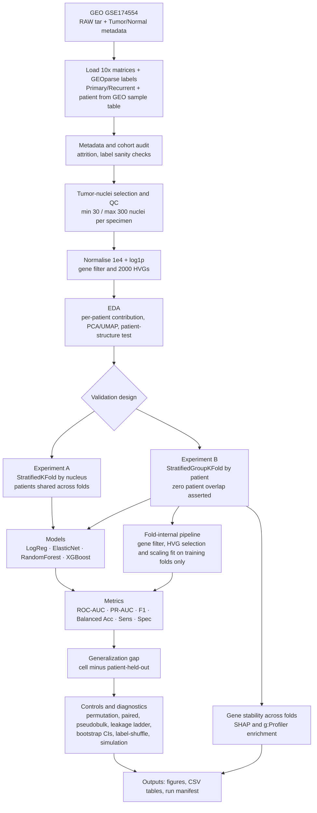

# Leakage-Aware Machine Learning for Primary vs Recurrent Glioblastoma Classification

**Maryam Zafar · 25i-8033 · MS Data Science (NU Islamabad) · DSTT Semester Project, Fall 2026**

A single-nucleus RNA-seq study (GEO [GSE174554](https://www.ncbi.nlm.nih.gov/geo/query/acc.cgi?acc=GSE174554)) that asks a simple question: **how much does a model's apparent accuracy drop when it has to classify nuclei from a patient it has never seen?**

Nuclei from the same patient are strongly correlated. If a random cell-level split puts them in both training and test folds, the model can recognise the *patient* rather than learn *recurrence*. This project measures that inflation and checks which findings survive patient-level validation.

---

## Key finding

| | Cell-level CV (leaky) | Patient-held-out CV | Gap |
|---|---|---|---|
| Best ROC-AUC | **0.956** (XGBoost) | **0.579** (Random Forest) | ≈ 0.33 to 0.38 |

Under patient-held-out validation, all four models perform near chance (ROC-AUC 0.55 to 0.58, with fold SD up to about 0.1). None of the six pre-declared significance tests survives Holm correction (minimum adjusted p = 0.239).


---

## Research questions

1. **RQ1.** Can classical ML distinguish primary vs recurrent GBM nuclei from transcriptomic profiles?
2. **RQ2.** How does performance change from cell-level to patient-held-out cross-validation?
3. **RQ3.** Which genes are stable across patient-held-out folds, and which biological processes are enriched among them?

---

## Pipeline



### Step by step

| Part | What happens |
|---|---|
| 1 to 2 | Setup, config, data loading and metadata audit. Labels come from the GEO sample table (`progression` = status, `pair#` = patient). |
| 3 | Tumor-specimen selection, QC, normalisation and global 2,000-HVG selection (kept as a **sensitivity analysis**). |
| 4 | EDA: patient/specimen contribution, QC distributions, PCA/UMAP, patient-vs-status neighbour test. |
| 5 to 6 | Experiment A (cell-level CV) vs Experiment B (patient-held-out CV), four models, repeated 5-fold x 2. |
| 7 | Exploratory gene stability, SHAP and pathway enrichment. |
| 8 | Cohort attrition audit, fold-internal HVG pipeline (**preferred estimate**), specimen-level aggregation, patient bootstrap, label-shuffle control, stability null, run manifest. |

---

## Dataset

- **Source:** GSE174554, "A single cell atlas of human glioma under therapy" (Wang et al., 2022, *Nature Cancer*). snRNA-seq of IDH-wildtype GBM specimens.
- **Unit of analysis:** individual nuclei from tumor specimens. The `Tumor` tag in the metadata is specimen-level, so the README and notebook say "nuclei from tumor specimens", not "verified malignant cells".
- **Label:** `Recurrent` (positive class) vs `Primary`. This is a disease timepoint, **not** therapy resistance.

| Stage | Count |
|---|---|
| Nuclei loaded | 34,672 |
| Specimens loaded / patients | 67 / 46 |
| After QC and per-specimen cap (modelled) | **17,965 nuclei · 64 specimens · 45 patients** |
| Patients with both Primary and Recurrent specimens | 19 |
| Class balance (modelled) | 60.5% Recurrent |
| Features | 2,000 HVGs |

> The raw data is **not** included in this repository. Download it from GEO (see below).

---

## Models and validation

| Model | Settings |
|---|---|
| Logistic Regression | StandardScaler, L2, C = 0.05, class-balanced |
| Elastic Net (LR) | StandardScaler, saga, l1_ratio = 0.5, C = 0.05 |
| Random Forest | 300 trees, sqrt features, min leaf 3, balanced subsample |
| XGBoost | 300 trees, depth 4, lr 0.1, subsample 0.8, colsample 0.5 |

- **Experiment A:** `StratifiedKFold` by nucleus (intentionally optimistic).
- **Experiment B:** `StratifiedGroupKFold` with patient as the group. The code asserts that no patient appears in both train and test.
- **Patient ID is used only for grouping, never as a feature.**
- 5 folds x 2 repeats = 10 folds per model. Seed 42. Hyper-parameter tuning is off (`TUNE = False`).
- F1, sensitivity and specificity use a fixed 0.5 threshold. An always-predict-Recurrent baseline reaches F1 = 0.754, higher than most patient-level F1 scores.

---

## Results

### 1. Cell-level vs patient-held-out (mean over folds, global-HVG analysis)

| Model | ROC-AUC cell | ROC-AUC patient | Gap | PR-AUC cell | PR-AUC patient | Bal. Acc cell | Bal. Acc patient |
|---|---|---|---|---|---|---|---|
| LogReg | 0.881 | 0.551 | 0.330 | 0.917 | 0.673 | 0.801 | 0.526 |
| ElasticNet | 0.892 | 0.552 | 0.341 | 0.926 | 0.673 | 0.812 | 0.529 |
| RandomForest | 0.952 | 0.579 | 0.373 | 0.969 | 0.677 | 0.866 | 0.560 |
| XGBoost | 0.956 | 0.573 | 0.382 | 0.971 | 0.679 | 0.887 | 0.545 |

Chance level: ROC-AUC 0.5, PR-AUC = prevalence = 0.605.

### 2. Fold-internal preprocessing (preferred estimate)

Gene filtering, HVG selection and scaling are re-fit on each training fold. Results barely change, so the gap is not an artefact of global HVG selection.

| Model | ROC-AUC cell | ROC-AUC patient (± SD) |
|---|---|---|
| LogReg | 0.886 | 0.557 ± 0.085 |
| RandomForest | 0.951 | 0.594 ± 0.096 |

Specimen-level aggregation (average nuclei probabilities per specimen) gives patient-held-out AUC 0.622 (LogReg) and 0.659 (RF). Patient-bootstrap CIs on the specimen-level AUC are about 0.50 to 0.75 (LogReg) and 0.52 to 0.78 (RF). The cell-minus-patient gap is 0.376 (95% CI 0.247 to 0.499) for LogReg and 0.336 (0.214 to 0.462) for RF.

### 3. Where does the leakage come from?


| Rung | LogReg AUC | RF AUC |
|---|---|---|
| 1. Patient-held-out, genes selected inside folds (clean) | 0.545 | 0.554 |
| 2. Patient-held-out, all 2,000 genes (clean) | 0.542 | 0.558 |
| 3. Gene selection on all data (leak) | 0.658 | 0.612 |
| 4. Specimen-held-out (patient's other specimen in train) | 0.557 | 0.597 |
| 5. Random cell split | 0.824 | 0.918 |

Most of the inflation comes from **same-specimen** nuclei sharing train and test (+0.27 / +0.32 AUC), not from a patient's other specimen (+0.01 / +0.04). The ladder is a diagnostic and uses its own cell cap (100 per specimen) and 200 selected genes.

Supporting evidence:
- **Patient structure:** a nucleus's nearest neighbours share its patient 70.4% of the time (chance 2.5%) vs share its status 84.6% (chance 52.2%).
- **Label-shuffle control:** with specimen labels shuffled across patients (no biological signal), cell-level AUC is still **0.803** vs 0.496 patient-held-out.
- **Simulation:** label-free data with patient offsets reproduces cell-level AUC near 1.0 and patient-level AUC near 0.5.

### 4. Significance and robustness (pre-declared family of 6 tests)

| Test | Raw p | Holm p |
|---|---|---|
| Patient-held-out LogReg (primary) | 0.164 | 0.386 |
| Patient-held-out RandomForest | 0.129 | 0.386 |
| Paired patients (n = 19), LogReg | 0.040 | 0.239 |
| Paired patients (n = 19), RandomForest | 0.059 | 0.239 |
| Pseudobulk LogReg | 0.159 | 0.386 |
| Pseudobulk RandomForest | 0.040 | 0.239 |

- Paired differential expression on 19 patients: **0 genes** at FDR < 0.10.
- Cell-state composition baseline (MES/AC/OPC/NPC marker scores): patient-held-out AUC 0.374, p = 0.726.
- Batch confounding cannot be excluded: GEO provides no validated sequencing-batch variable, so no batch correction is applied.

### 5. Gene stability, SHAP and pathways (exploratory)

- Random Forest has 91 genes in the top-100 of at least 60% of patient-held-out folds (84 shared by at least 2 models).
- The observed stability is **not distinguishable from a label-permuted null** (Jaccard 0.273 vs null 0.259, p = 0.333, 20 permutations).
- Many top genes are neuronal or synaptic (e.g. `RBFOX1`, `NRXN3`, `CADM2`, `GRID2`), which may reflect ambient RNA or neuronal contamination rather than recurrence biology.
- The fold-internal g:Profiler run finds **no pathways at adjusted p < 0.05** against the 2,000-HVG background.

---

## Repository structure

```
.
├── GBM_Leakage_Aware_ML.ipynb      # full pipeline (rename of GBM_Leakage_Aware_ML_new (3).ipynb)
├── assets/
│   ├── generalization_gap.png
│   └── leakage_ladder.png
└── README.md
```

Running the notebook creates this outputs folder on Google Drive:

```
DSTT_GBM/
├── data/
│   ├── GSE174554_RAW.tar
│   └── GSE174554_Tumor_normal_metadata.txt.gz
└── GBM_leakage_project_outputs/
    ├── figures/        # eda_*, results_*, ladder_*, ci_*, sim_* PNGs
    ├── cache/          # pickled CV results
    ├── *.csv           # metrics, bootstrap CIs, stability, enrichment, ...
    └── run_manifest.json
```

---

## How to run

The notebook is built for **Google Colab** (no GPU needed).

1. Download from GEO [GSE174554](https://www.ncbi.nlm.nih.gov/geo/query/acc.cgi?acc=GSE174554): `GSE174554_RAW.tar` and `GSE174554_Tumor_normal_metadata.txt.gz`.
2. Put both in `MyDrive/DSTT_GBM/data/`.
3. Open the notebook in Colab and mount Drive.
4. Edit only the **CONFIG** cell if your paths differ.
5. Run top to bottom. Slow steps are cached to Drive and resume after a crash.

Set `USE_SYNTHETIC_DEMO = True` to test the pipeline on fake data without downloading anything.

### Main configuration

| Setting | Value |
|---|---|
| `POSITIVE_LABEL` | `"Recurrent"` |
| `MIN_CELLS_PER_SAMPLE` / `MAX_CELLS_PER_SAMPLE` | 30 / 300 |
| `N_HVG` | 2000 |
| `N_SPLITS` x `N_REPEATS` | 5 x 2 |
| `SEED` | 42 |
| `TOP_K_GENES` / `STABLE_MIN_FREQ` | 100 / 0.6 |

### Dependencies

`scanpy`, `anndata`, `umap-learn`, `scikit-learn`, `xgboost`, `shap`, `gprofiler-official`, `GEOparse`, `pyreadr`, `statsmodels`, `pandas`, `numpy`, `scipy`, `seaborn`, `matplotlib`, `tqdm`. The first notebook cell installs them. Exact versions used are in `run_manifest.json`.

---

## Interpretation cautions

- **Recurrent is not therapy-resistant.** The label is a disease timepoint.
- **Tumor specimen is not a verified malignant nucleus.** No independent cell-type or CNV malignancy call is used.
- **Importance is not causation.** Stable genes and pathways are exploratory, not validated biomarkers.
- **Patient-held-out CV is the honest estimate**, and it is within-cohort only. External validation on an independent cohort is future work.
- Limits: per-specimen cell cap, only 19 paired patients, fixed 0.5 threshold, possible batch confounding.

---

## Data and citation

- Wang L. *et al.* *Nature Cancer* 3, 1534 to 1552 (2022). Data: GEO GSE174554, "A single cell atlas of human glioma under therapy".
- Public, anonymised data. No new patient recruitment. No clinical claims are made.

## Author

Maryam Zafar (25i-8033), MS Data Science, NU Islamabad. Data Science Tools & Techniques (DSTT), Fall 2026.
